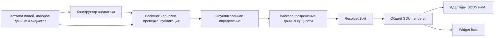

# Архитектура Split Studio

Split Studio — самостоятельный прототип конструктора SDUI Split-view на React, TypeScript, SDDS FinAI и Node.js. Аналитик выбирает данные и собирает карточку из семантических блоков. Backend проверяет определение, хранит черновик и опубликованные версии, подставляет данные сущности. Один renderer используется в предпросмотре и в рабочем сплите.

Область первой версии: просмотр сущностей из backend provider, заголовок и статус, вкладки, группы полей, сворачиваемые разделы, текст, ссылки, таблицы связанных записей и интеграция виджетов через SberERPConnector. Примеры используют `asset`; тип и данные не ограничены этими примерами. Редактирование бизнес-полей, формы и комментарии в самом SDUI пока не реализованы; зарегистрированные микрофронты получают параметры и обработчики хоста.

## Состав

Это логические модули одного приложения, а не требование разворачивать отдельный микросервис для каждого прямоугольника.

| Модуль | Интерфейс и ответственность |
| --- | --- |
| Конструктор | Изменяет `SplitTemplate`, предоставляет типизированный выбор данных и подсказки, показывает ошибки определения. |
| Каталог — `shared/catalog.ts` или `ServerOptions.catalog` | Публикует подсказки полей и наборов данных, поддерживаемые типы блоков и зарегистрированные ID виджетов. Пути к данным произвольные. |
| Проверка — `shared/validation.ts` | Проверяет структуру, безопасные пути/JSON, декларации событий и зарегистрированные виджеты. Возвращает `ValidationIssue` с путём и, когда возможно, ID узла. |
| Хранилище — `server/store.ts` | Разделяет изменяемый черновик, его версию и неизменяемые публикации. |
| Разрешение данных — `server/resolve.ts` | Соединяет определение с разрешёнными данными выбранной сущности и возвращает `ResolvedSplit`. |
| Renderer — `src/runtime/SplitView.tsx` | Отображает поддерживаемые семантические блоки. Сохраняет локальное состояние чтения по стабильным ID. |
| Адаптеры UI kit — `src/ui.tsx` и renderer | Преобразуют семантическую модель в конкретные компоненты FinAI. React props не становятся серверным контрактом. |
| Widget host — renderer и `src/runtime/widgets.ts` | Контролирует встраивание и открытие зарегистрированных виджетов, их жизненный цикл и результаты. |

## Три разных вида состояния

### Определение

`SplitTemplate` отвечает на вопрос «какая карточка должна быть показана»: поля и их подписи, порядок вкладок, разделы, таблицы, настройки оболочки и ссылка на зарегистрированный виджет. В нём нет DOM, React-компонентов, функций или URL загрузки микрофронтенда.

### Разрешённый экземпляр

`ResolvedSplit` отвечает на вопрос «что показать для этой сущности по этой версии шаблона»: определение, `data`, `errors`, ID экземпляра, ID сущности и её версия. Backend является источником данных и окончательных ограничений. Предпросмотр использует тот же формат, включая искусственные сценарии длинных, пустых данных и ошибок.

### Локальное состояние клиента

Активная вкладка, раскрытые разделы, ширина панели, fullscreen, поисковый запрос и страница таблицы принадлежат клиенту. Изменение этих значений не создаёт новую публикацию шаблона. Стабильный ID узла позволяет связать состояние с его смыслом, а не с позицией в массиве.

`defaultOpen` и `defaultWidth` задают исходное состояние. Их нельзя повторно применять при каждом обновлении данных, сбрасывая выбор пользователя. При смене сущности состояние требуется сохранять или сбрасывать осознанно для каждого типа блока.

## Жизненный цикл определения

1. Аналитик редактирует черновик с текущим `draftVersion`.
2. Сохранение отправляет ожидаемую версию черновика; несовпадение версий возвращается как конфликт. Сохранение допускает черновик с ошибками содержимого при корректной корневой структуре.
3. Проверка связывает ошибки с конкретными настройками конструктора.
4. Публикация создаёт новый снимок `PublishedVersion` с номером `revision` и временем создания.
5. `activeRevision` определяет версию, используемую при открытии рабочего сплита.
6. Изменение черновика не изменяет уже опубликованный снимок и не меняет открытый экземпляр само по себе.

Публикация — изменение определения интерфейса. Сохранение черновика — работа аналитика. Эти операции не изменяют бизнес-данные сущности.

## Управление сплитом

Backend управляет содержимым, структурой и доступной конфигурацией через определение и разрешение экземпляра. Клиент обрабатывает непосредственные действия оболочки: закрытие, изменение ширины, fullscreen и переключение вкладки.

Вызов внешнего виджета оформляется отдельным `OpenWidgetIntent`, а не превращается в произвольный HTTP-запрос из шаблона. Результат виджета может потребовать обновить данные текущего экземпляра; детали корреляции описаны в [WIDGETS.md](./WIDGETS.md).

В первой версии не закладывается произвольная серверная машина состояний, поток UI-патчей или выполнение выражений JavaScript. Это отдельное расширение протокола, которому потребуются собственные гарантии порядка, совместимости и восстановления.

## Загрузка и ошибки

Данные таблиц в первой версии являются снимком из `ResolvedSplit`. Поиск и пагинация выполняются на клиенте по уже полученному набору. Размер страницы не является гарантией, что backend передал только одну страницу.

Ошибка блока передаётся как `BlockError` с `nodeId`. Допустимая локальная ошибка должна оставаться в своём разделе и позволять читать остальные данные. Ошибка загрузки всего экземпляра требует состояния восстановления на уровне панели. Неподдерживаемый обязательный блок не следует молча скрывать.

## Доверие и ограничения прототипа

- Клиентское скрытие блока не заменяет авторизацию. В production backend должен проверять доступ к сущности, полям, наборам данных и операциям независимо от конструктора.
- ID виджетов выбираются из каталога хоста. Значения задаются явно или берутся из произвольных путей в данных API; каталог полей даёт подсказки. Аналитик не задаёт import URL или исполняемый код.
- Локальный файловый репозиторий демонстрирует хранение. Он не заменяет production БД, транзакции, журнал аудита и координацию нескольких серверных процессов.
- В прототипе нет корпоративной авторизации, реальных enterprise API и промышленного развертывания. Примеры данных синтетические.
- Встроенный демонстрационный виджет показывает хостовый контракт. Это не подключённый промышленный микрофронтенд.
- `schemaVersion: 1` обозначает текущий формат. `/api/resolve` умеет проверить явно переданные `nodeTypes`/`widgetIds` клиента и отклонить несовместимый шаблон. Автоматический подбор fallback, несколько версий схемы и миграции требуют отдельной реализации.

## Путь развития

Сначала проверить сценарий «аналитик собрал карточку → опубликовал → пользователь открыл сущность» на существующих макетах. Затем подключать реальные каталоги, backend providers и зарегистрированные микрофронты. Формы, комментарии и серверные таблицы добавляются расширением контракта и реестра блоков, сохраняя общий renderer и явное владение состоянием.
